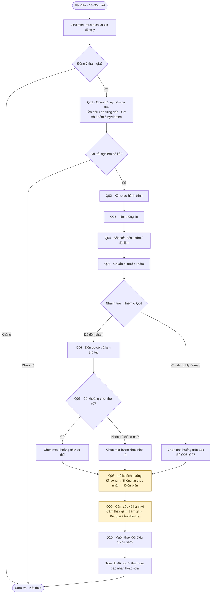

# Interview guide — Lần đầu đến khám và trải nghiệm chờ trước phòng khám

## Mục tiêu và cách dùng
- **Mục tiêu:** tìm hiểu hành trình từ khi phát sinh nhu cầu khám đến khi vào phòng khám lâm sàng; phân tích cảm xúc và hành vi trong thời gian chờ, đặc biệt ở lần đầu đến một cơ sở y tế. Qua đó, xác định cơ hội nâng cao trải nghiệm khách hàng, bao gồm khả năng ứng dụng trí tuệ nhân tạo (AI).
- **Giả thuyết trọng tâm:** việc thiếu thông tin về thời gian chờ và thời điểm hoàn tất khám có thể ảnh hưởng đến trải nghiệm cũng như khả năng sắp xếp công việc, học tập của khách hàng. Cần tìm hiểu liệu việc xây dựng gói dịch vụ hỗ trợ lập kế hoạch và quản lý thời gian khám có thể đáp ứng nhu cầu này và nâng cao trải nghiệm khách hàng hay không.
- **Cần tìm hiểu:** kỳ vọng trước khi chờ; thông tin thực tế nhận được; diễn biến cảm xúc; hành động tiếp theo và những ảnh hưởng liên quan. Ghi nhận cả các trường hợp chờ lâu nhưng vẫn cảm thấy thoải mái, hoặc đã biết thời gian chờ nhưng vẫn không hài lòng.
- **Phạm vi bối cảnh:** Vinmec/MyVinmec là bối cảnh ứng dụng hướng tới. Trải nghiệm tại các cơ sở y tế công lập hoặc tư nhân khác được ghi nhận làm nguồn đối chiếu. “Lần đầu” được hiểu là lần đầu đến cơ sở đó, kể cả khi người tham gia đã có kinh nghiệm khám tại nơi khác.
- **Hình thức:** phỏng vấn trong 15–20 phút, bắt đầu bằng câu hỏi mở, sau đó sử dụng câu hỏi gợi mở để tìm hiểu sâu hơn. Mỗi buổi tập trung vào một lần khám hoặc một lần sử dụng ứng dụng cụ thể.
- **Phân bổ dự kiến:** mở đầu và xác định bối cảnh 3 phút; tìm hiểu hành trình 7 phút; phân tích sâu trải nghiệm chờ 6 phút; kết thúc 2 phút. Các câu hỏi gợi mở được sử dụng linh hoạt, hỏi lần lượt từng nội dung và không bắt buộc sử dụng toàn bộ.

## 1. Mở đầu và đồng thuận
_“Cảm ơn anh/chị đã dành thời gian. Em đang làm bài học tập về trải nghiệm từ lúc có nhu cầu đi khám đến khi vào gặp bác sĩ. Cuộc trao đổi khoảng 15–20 phút, có cả câu hỏi về điều thuận lợi và chưa thuận lợi. Em chỉ hỏi về trải nghiệm dịch vụ, không hỏi bệnh hay chẩn đoán. Anh/chị có thể bỏ qua câu hỏi hoặc dừng bất cứ lúc nào. Em xin ghi chép bằng mã ẩn danh để phân tích cho bài làm. Anh/chị có đồng ý tham gia và cho em ghi chép không?”_

## 2. Chọn trải nghiệm để kể — Q01
**Q01. Anh/chị có thể kể về một lần gần đây lần đầu đến khám tại một cơ sở y tế không?**
- **Nhánh A — đã đến khám:** dùng Q02–Q10, chỉ hỏi những bước họ thực sự trải qua. Không bắt buộc từng dùng app hoặc khám tại Vinmec.
- **Nhánh B — chỉ dùng MyVinmec:** Q02 kể từ lúc mở app đến lúc dừng; Q03–Q05 chỉ hỏi việc đã làm hoặc thông tin đã thấy; bỏ Q06–Q07, dùng Q08–Q10 cho một tình huống thực sự có trên app.
- **Chưa có cả hai:** kết thúc phần phỏng vấn này.

## 3. Kể lại hành trình — Q02–Q07
**Q02. Anh/chị kể lại các bước đã trải qua trong lần đó, từ lúc bắt đầu tìm cách đi khám đến khi vào gặp bác sĩ được không?**
Để người tham gia kể tự do trước. Nếu đã trả lời các câu dưới thì chỉ hỏi bổ sung chỗ còn thiếu; không đọc sẵn danh sách bước để họ kể theo.

**Q03. Lúc bắt đầu, anh/chị tìm thông tin để đi khám bằng cách nào?**
Gợi mở: thông tin nào họ tìm trước; điều gì giúp họ quyết định; phần nào rõ hoặc còn thiếu. Không hỏi lý do y khoa khiến họ đi khám.

**Q04. Trong lần đó, anh/chị sắp xếp việc đến khám như thế nào?**
Nếu đặt lịch: nhờ họ kể cách đặt và cách biết lịch đã được ghi nhận. Nếu đến trực tiếp: hỏi họ biết cách đến khám bằng nguồn nào. Nếu dừng giữa chừng: hỏi dừng ở bước nào và chuyện gì xảy ra.

**Q05. Trước khi đến, anh/chị đã chuẩn bị những gì cho việc làm thủ tục?**
Gợi mở: họ biết cần chuẩn bị bằng cách nào; đến nơi có khác với điều đã hiểu không. Với nhánh B, hỏi thông tin chuẩn bị trước khám mà họ thực sự thấy trên app. Không xem hoặc sao chụp giấy tờ.

**Q06. Khi đến cơ sở đó, anh/chị đã làm gì đầu tiên?**
Gợi mở lần lượt: chuyện gì xảy ra tiếp theo; ở một lần chuyển bước cụ thể, họ biết cần đến đâu hoặc làm gì bằng cách nào; người đi cùng hỗ trợ việc gì nếu có.

**Q07. Từ lúc đến cơ sở đến lúc vào phòng khám, anh/chị có phải chờ ở bước nào không?**
Nếu có, nhờ kể các khoảng chờ đã trải qua rồi chọn một khoảng chờ nhớ rõ để đào sâu ở Q08–Q09. Nếu không chờ hoặc không nhớ, ghi đúng như vậy và hỏi một tình huống khác ở Q08. Nếu chưa vào được phòng khám, ghi đúng điểm hành trình dừng lại.

## 4. Đào sâu một khoảng chờ — Q08–Q09
**Q08. Anh/chị kể cụ thể khoảng chờ vừa chọn, từ lúc bắt đầu chờ đến khi chuyển sang bước tiếp theo được không?**
Để họ kể trước. Chọn câu gợi mở còn thiếu và hỏi từng ý:
- Trước khi bắt đầu chờ, anh/chị nghĩ khoảng chờ đó sẽ diễn ra thế nào?
- Trong lúc chờ, anh/chị nhận được thông tin gì? Từ đâu?
- Lúc đó, anh/chị hiểu thế nào về thời điểm mình được chuyển sang bước tiếp theo?
- Nếu có thông báo thời gian, sau đó thực tế diễn ra thế nào? Nếu họ nhắc thông báo thay đổi, hỏi chuyện gì xảy ra sau lần thay đổi đó.
- Nếu cần hỏi thời lượng: “Anh/chị có nhớ khoảng bao lâu không?” Ghi rõ ước lượng hồi tưởng; tách thời gian đã chờ với thời gian được thông báo trước.

**Q09. Trong khoảng chờ đó, anh/chị cảm thấy thế nào?**
Chọn câu gợi mở để hiểu cảm xúc và hành vi, không gợi tên cảm xúc trước:
- Cảm giác đó có thay đổi trong lúc chờ không? Điều gì xảy ra vào lúc thay đổi?
- Lúc đó anh/chị đã làm gì? Sau đó chuyện gì xảy ra?
- Khoảng chờ này ảnh hưởng thế nào đến những việc khác trong ngày của anh/chị, nếu có?
- Có điều gì trong lần đó giúp anh/chị thấy ổn hơn khi chờ không?
- Nếu họ tự nhắc một thông tin còn thiếu: “Nếu có thông tin đó vào lúc ấy, anh/chị nghĩ mình có thể quyết định hoặc làm gì khác?” Ghi câu này là mong muốn giả định, không phải hành vi đã xảy ra.

## 5. Kết thúc — Q10
**Q10. Nếu được thay đổi một điều trong trải nghiệm vừa kể, anh/chị muốn thay đổi điều gì?**
Hỏi vì sao điều đó có ý nghĩa với họ. Sau đó tóm tắt ngắn: “Em hiểu tình huống chính là …, ảnh hưởng là …; em hiểu vậy đã đúng chưa? Có điều gì anh/chị muốn bổ sung hoặc sửa lại không?” Cảm ơn người tham gia.

## 6. Sơ đồ luồng phỏng vấn

**Trọng tâm Q08–Q09:** việc biết hoặc chưa biết thời gian còn chờ liên quan thế nào đến cảm xúc và hành động. Với nhánh app hoặc không có khoảng chờ, hỏi theo tình huống thực sự đã chọn. Ghi cả trải nghiệm thuận lợi.
