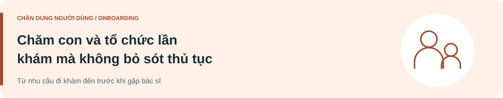

[Minh An](P01-minh-an.md) · **Thanh Hà** · [Minh Đức](P03-minh-duc.md)

# Thanh Hà

Persona · Bản final 19/10/2026 · Giả thuyết chưa xác thực

> "Chờ tại bệnh viện thực sự là 1 cản trở lớn cho công việc của tôi, nhất là khi con cái bị ốm bất chợt, tôi phải bỏ luôn công việc để cho con đi khám, mà khám thì cũng chả biết bao giờ xong và sợ nhất giao ca sáng - chiều"

**[Khám phá hành trình của Thanh Hà →](../../02-journey-map/J02-thanh-ha.md)**

---

## Mục tiêu & động lực

| 🎯 Mục tiêu của người dùng | ✦ Điều thúc đẩy hành động |
| :--- | :--- |
| **Đưa con đến đúng lượt khám và vẫn chăm sóc được con trong suốt quá trình chờ gặp bác sĩ.**  **Kết quả mong muốn**  • Hiểu việc cần làm trước khi vào khám để tránh đưa con đi lại hoặc chờ thêm vì thiếu thông tin.  • Thu xếp thời gian cho lần khám và việc gia đình dựa trên thông tin được cơ sở xác nhận. | • Muốn con được tiếp cận việc khám mà không phải chịu thêm bất tiện do người lớn chưa rõ thủ tục.  • Giữ sự chú ý cho con thay vì liên tục tìm thông tin hoặc hỏi lại nhiều nơi.  • Cảm thấy mình đã chuẩn bị đủ và chủ động được những phần thuộc trách nhiệm của phụ huynh. |

## Chân dung

| Độ tuổi | Giai đoạn cuộc sống | Vai trò trong lần khám |
| :--- | :--- | :--- |
| **39** | **Đã có gia đình, có con.** | **Phụ huynh đưa con đi khám ngoại trú.** |

*Không gán giới tính, nghề nghiệp, nơi ở hoặc thu nhập khi chưa có căn cứ.*

**Nhóm người dùng** 
Người 37-45 tuổi, đã có gia đình, đưa con đi khám.

**Vai trò trong lần khám** 
Phụ huynh trực tiếp thu xếp lịch và đi cùng con; con là người được khám.

## Bối cảnh

Hà cần thu xếp một lần khám cho con tại cơ sở chưa quen. Trong kịch bản này, Hà là người đặt lịch, chuẩn bị giấy tờ và trực tiếp đi cùng; chưa có người khác chia sẻ thủ tục tại viện. Hà từng tự tổ chức việc khám cho gia đình, nhưng cách đăng ký và gọi lượt tại cơ sở này còn mới. Khi cần chăm hoặc trấn an con, Hà phải tạm dừng đọc hướng dẫn và thao tác

### Kỹ năng và mức quen thuộc

Dùng điện thoại để tìm thông tin, nhận xác nhận hẹn và lưu giấy tờ; biết mô tả nhu cầu của con để hỏi nhân viên. Chưa quen phân biệt hồ sơ người đặt lịch với hồ sơ người được khám. Việc theo dõi thông tin có thể bị ngắt quãng khi chăm con; không đồng nghĩa với thiếu kỹ năng số.

## Kỳ vọng & rào cản

| ✓ Kỳ vọng với dịch vụ | ⚠ Những điều gây khó khăn |
| :--- | :--- |
| • Xác nhận hẹn hiển thị rõ tên con, thông tin người liên hệ, cơ sở và trạng thái lịch.  • Hướng dẫn chuẩn bị phù hợp với lần khám của con, có thể đọc lại khi việc chăm con làm gián đoạn.  • Biết điểm tiếp đón, phòng chờ và người cần hỏi khi hướng dẫn chưa rõ.  • Được giải thích cách xử lý nếu cần đưa con tạm rời khu chờ; không phải tự đoán có mất lượt hay không. | • Dễ mất công sửa lại nếu thông tin của người đặt lịch và trẻ được khám bị hiểu nhầm.  • Hướng dẫn dài, rải rác hoặc không giữ được tiến độ khiến phải đọc và làm lại sau khi chăm con.  • Vừa để ý con vừa nghe gọi lượt có thể khiến bỏ sót thông báo quan trọng.  • Không biết cần báo ai khi con cần đi vệ sinh hoặc tạm rời khu chờ; chưa xác minh quy định gọi lại của cơ sở. |

---

<strong>Nguồn nội dung và ghi chú phương pháp</strong>

Tên hư cấu; nội dung theo bản final tác giả cung cấp ngày 19/10/2026. Chân dung, câu nói và hành trình chưa được xác thực qua nghiên cứu.

[Đề bài](../../README.md) · [Phương pháp và nguồn](../../04-best-practice/README.md#phuong-phap-persona-journey)

Nguồn bối cảnh: [hồ sơ cá nhân và người thân MyVinmec](https://www.vinmec.com/vie/bai-viet/huong-dan-ket-noi-ho-so-y-te-va-so-tiem-chung-tren-ung-dung-myvinmec-vi).

**[Xem user journey →](../../02-journey-map/J02-thanh-ha.md)**

[Minh An](P01-minh-an.md) · **Thanh Hà** · [Minh Đức](P03-minh-duc.md)
