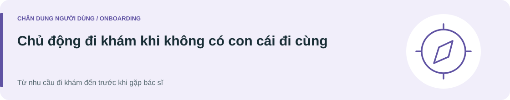

[Minh An](P01-minh-an.md) · [Thanh Hà](P02-thanh-ha.md) · **Minh Đức**

# Minh Đức

Persona · Bản final 19/10/2026 · Giả thuyết chưa xác thực

> "Lắm lúc con cái tôi chỉ giúp tôi đi khám được vài buổi đầu, sau đó bệnh trường tôi phải tự đi khám một mình, tôi cũng không biết dùng điện thoại quá thành thạo, nên hoàn toàn phụ thuộc vào nhân viên bệnh viện"

**[Khám phá hành trình của Minh Đức →](../../02-journey-map/J03-minh-duc.md)**

---

## Mục tiêu & động lực

| 🎯 Mục tiêu của người dùng | ✦ Điều thúc đẩy hành động |
| :--- | :--- |
| **Tự đi đến đúng phòng và vào khám, hiểu mình đang ở bước nào và chủ động nhận hỗ trợ khi cần.**  **Kết quả mong muốn**  • Kiểm tra lại được lịch, giấy tờ và nơi đến mà không phải chờ con cái giải thích.  • Giữ quyền lựa chọn cách nhận hướng dẫn và quyết định phần nào muốn tự làm. | • Tự chăm sóc sức khỏe theo kế hoạch mà không phụ thuộc hoàn toàn vào lịch rảnh của con cái.  • Giữ cảm giác tự chủ và được tôn trọng khi tiếp xúc với nhân viên.  • An tâm vì hiểu bước tiếp theo và biết cách kiểm tra lại thông tin thay vì phải đoán. |

## Chân dung

| Độ tuổi | Vai trò trong lần khám |
| :--- | :--- |
| **67** | **Tự thu xếp và đến khám, không có con cái đi cùng.** |

*Không suy ra sống một mình, đã nghỉ hưu, thu nhập hay tình trạng sức khỏe từ tuổi.*

**Nhóm người dùng** 
Người từ 65 tuổi trở lên, đi khám không có con cái đi cùng.

**Vai trò trong lần khám** 
Người trực tiếp đi khám và tự theo dõi các bước tiếp nhận; chọn hỗ trợ khi cần.

## Bối cảnh

Đức thu xếp một lần khám ngoại trú khi con cái không đi cùng. Kịch bản chọn là tự đến một cơ sở chưa quen và tự quyết định khi nào cần hỏi nhân viên. Đức có cách riêng để lưu thông tin hẹn, nhưng chưa quen đường đi và thứ tự tiếp nhận ở cơ sở này. Điều cần hỗ trợ là sự liên tục giữa các bước; không mặc định Đức cần con làm hộ hoặc gặp hạn chế nghe, nhìn hay nhận thức.

### Kỹ năng và mức quen thuộc

Có thể gọi điện, cung cấp thông tin cần thiết và dùng ghi chép để kiểm tra lại lịch, địa điểm. Mức sử dụng app chưa được xác nhận, nên hành trình có cả lựa chọn số và hỗ trợ trực tiếp.

## Kỳ vọng & rào cản

| ✓ Kỳ vọng với dịch vụ | ⚠ Những điều gây khó khăn |
| :--- | :--- |
| • Nhận xác nhận lịch theo kênh mình sử dụng được, có thể xem hoặc nghe lại.  • Hướng dẫn tới một điểm tiếp theo cụ thể, dùng tên phòng và địa điểm nhất quán với biển tại viện.  • Có đầu mối hỗ trợ dễ nhận biết khi chưa chắc đã làm đủ thủ tục hoặc đang chờ đúng chỗ.  • Nếu một kênh không dùng được trong lần khám đó, vẫn có cách tiếp tục và được giải thích trực tiếp khi cần. | • Nghe nhiều chỉ dẫn liên tiếp nhưng không có cách kiểm tra lại có thể khiến chưa chắc cần tới đâu trước.  • Tên điểm đến trên thông báo và biển tại viện không khớp có thể làm phải đi lại hoặc hỏi nhiều nơi.  • Không rõ đã được ghi nhận có mặt hay chưa, nên khó biết cần tiếp tục chờ hay hỏi.  • Nếu hướng dẫn chỉ có trên app trong lúc không dùng được điện thoại, hành trình có thể bị ngắt dù vẫn tự thực hiện được các bước khác. |

---

<strong>Nguồn nội dung và ghi chú phương pháp</strong>

Tên hư cấu; nội dung theo bản final tác giả cung cấp ngày 19/10/2026. Chân dung, câu nói và hành trình chưa được xác thực qua nghiên cứu.

[Đề bài](../../README.md) · [Phương pháp và nguồn](../../04-best-practice/README.md#phuong-phap-persona-journey)

Nguồn bối cảnh: [WHO về tuổi cao](https://www.who.int/news-room/fact-sheets/detail/ageing-and-health) · [Thông tin dễ tiếp cận](https://extranet.who.int/agefriendlyworld/age-friendly-practices/communication-and-information/).

**[Xem user journey →](../../02-journey-map/J03-minh-duc.md)**

[Minh An](P01-minh-an.md) · [Thanh Hà](P02-thanh-ha.md) · **Minh Đức**
