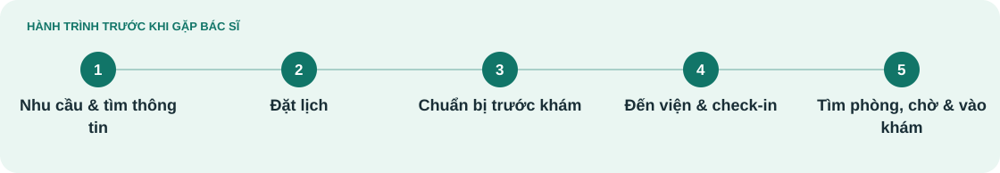

**Minh An** · [Thanh Hà](J02-thanh-ha.md) · [Minh Đức](J03-minh-duc.md)

# Hành trình của Minh An

**Tự tổ chức lần đi khám trong lịch làm việc**

User journey · Bản final 19/10/2026 · Giả thuyết chưa xác thực

[← Persona Minh An](../01-phong-van/persona/P01-minh-an.md)

## Bối cảnh & đích đến

**Mục tiêu của người dùng** 
Muốn biết tình hình bệnh của bản thân

| Kịch bản | Đích đến của hành trình |
| :--- | :--- |
| Một lần tự thu xếp khám ngoại trú tại cơ sở chưa quen, có thể bắt đầu bằng kênh số. Chưa xác định chuyên khoa hoặc cơ sở. | Biết lịch đang ở trạng thái nào, hoàn tất tiếp nhận theo hướng dẫn, tới đúng phòng và được mời vào; có cách hỏi khi kế hoạch đổi. |

## Bản đồ trải nghiệm

*Mỗi cột là một giai đoạn; đọc theo hàng để so sánh mục tiêu, điểm vướng và cảm xúc.*

| Góc nhìn | **[Nhu cầu & tìm thông tin](#nhu-cau-tim-thong-tin)** | **[Đặt lịch](#dat-lich)** | **[Chuẩn bị trước khám](#chuan-bi-truoc-kham)** | **[Đến viện & check-in](#den-vien-check-in)** | **[Tìm phòng, chờ & vào khám](#tim-phong-cho-vao-kham)** |
| :--- | :--- | :--- | :--- | :--- | :--- |
| **🎯 Mục tiêu** | Thấy được khả dĩ cho lần đi khám bệnh lần này | Biết lịch đã chốt chưa để sắp xếp việc làm. | Biết phải mang gì, đến đâu và khi nào. | Biết mình đã được tiếp nhận hay còn thiếu bước. | Đến đúng phòng và biết khi nào cần có mặt để vào khám. |
| **⚠ Điểm vướng** | Thông tin rải rác khiến chưa biết nguồn nào đủ tin. | Không phân biệt chờ xác nhận và đã xác nhận; khó tìm cách đổi kế hoạch. Mất công tìm hiểu bệnh lý để đặt cho đúng | Thiếu hướng dẫn phù hợp có thể dẫn đến chuẩn bị chưa đủ. | Có hẹn nhưng tưởng đã xong tiếp nhận; không biết còn phải làm gì. | Không rõ đang chờ bước nào hoặc nên hỏi ai nếu chưa được gọi. |
| **♡ Cảm xúc** | Phân vân không biết nên khám hoặc không biết ở đây có khám như mình tưởng không | Ngợp trước lượng thông tin khổng lồ phải tiếp nhận | Bồn chồn vì không biết chuẩn bị đủ chưa | Lúng túng khi chuyển từ app sang quầy. | Sốt ruột vì lịch làm |

## Hành động & cơ hội

*Điểm tiếp xúc là kênh theo kịch bản; cơ hội là đề xuất tương lai.*

| Góc nhìn | **[Nhu cầu & tìm thông tin](#nhu-cau-tim-thong-tin)** | **[Đặt lịch](#dat-lich)** | **[Chuẩn bị trước khám](#chuan-bi-truoc-kham)** | **[Đến viện & check-in](#den-vien-check-in)** | **[Tìm phòng, chờ & vào khám](#tim-phong-cho-vao-kham)** |
| :--- | :--- | :--- | :--- | :--- | :--- |
| **Hành động** | • Tìm hiểu ban đầu xem đi khám cần làm gì  • Hỏi người quen/phụ huynh cách khám chữa tại các cơ sở bệnh viện  • Tìm hiểu về địa điểm khám  • Ước tính chi phí phát sinh có thể có  • Xếp lịch rảnh để tiện đi khám | Gửi yêu cầu hẹn; đọc trạng thái; hỏi lại nếu chưa rõ hoặc muốn thay đổi. | Xem hướng dẫn; tập hợp giấy tờ được yêu cầu; tính đường đi. | Đến điểm tiếp đón; xuất trình thông tin; hoàn tất bước được hướng dẫn. | • Tìm khu chờ  • Theo dõi thông báo;  • Vào phòng khi được gọi. |
| **Điểm tiếp xúc** | Website chính thức, người quen giới thiệu | MyVinmec/web/điện thoại tùy kênh thực sự dùng. | Thông báo hẹn, hướng dẫn chính thức, điện thoại hỗ trợ. | Biển chỉ dẫn, nhân viên tiếp đón; app nếu cơ sở áp dụng. | Biển phòng, phiếu/hệ thống gọi lượt, nhân viên khu chờ. |
| **✦ Cơ hội cải thiện** | • Người bệnh tiếp thu thông tin đúng nhu cầu, thời điểm   • Ưu đãi lần đầu/trở lại | • Hoàn tất mục tiêu chỉ trong 1-2 phút  • Công khai chi phí khám dự tính | • Tư vấn tiền lâm sàng  • Hiểu rõ nhu cầu trước khi người bệnh onboard | • Thủ tục nhanh  • Tránh xếp hàng  • Khiến cho việc đặt lịch là sự ưu tiên đúng nghĩa | • Bản đồ hướng dẫn quy trình khám xuyên suốt  • Thông báo app,... |

---

## Đọc theo từng giai đoạn

*Mở một giai đoạn để trình bày chi tiết hoặc đọc trên màn hình nhỏ.*

<strong>Nhu cầu & tìm thông tin</strong>

| Góc nhìn | Nội dung |
| :--- | :--- |
| **Mục tiêu** | Thấy được khả dĩ cho lần đi khám bệnh lần này |
| **Hành động** | • Tìm hiểu ban đầu xem đi khám cần làm gì  • Hỏi người quen/phụ huynh cách khám chữa tại các cơ sở bệnh viện  • Tìm hiểu về địa điểm khám  • Ước tính chi phí phát sinh có thể có  • Xếp lịch rảnh để tiện đi khám |
| **Kênh / điểm tiếp xúc** | Website chính thức, người quen giới thiệu |
| **Điểm vướng** | Thông tin rải rác khiến chưa biết nguồn nào đủ tin. |
| **Cảm xúc** | Phân vân không biết nên khám hoặc không biết ở đây có khám như mình tưởng không |
| **Cơ hội cải thiện** | • Người bệnh tiếp thu thông tin đúng nhu cầu, thời điểm   • Ưu đãi lần đầu/trở lại |

<strong>Đặt lịch</strong>

| Góc nhìn | Nội dung |
| :--- | :--- |
| **Mục tiêu** | Biết lịch đã chốt chưa để sắp xếp việc làm. |
| **Hành động** | Gửi yêu cầu hẹn; đọc trạng thái; hỏi lại nếu chưa rõ hoặc muốn thay đổi. |
| **Kênh / điểm tiếp xúc** | MyVinmec/web/điện thoại tùy kênh thực sự dùng. |
| **Điểm vướng** | Không phân biệt chờ xác nhận và đã xác nhận; khó tìm cách đổi kế hoạch. Mất công tìm hiểu bệnh lý để đặt cho đúng |
| **Cảm xúc** | Ngợp trước lượng thông tin khổng lồ phải tiếp nhận |
| **Cơ hội cải thiện** | • Hoàn tất mục tiêu chỉ trong 1-2 phút  • Công khai chi phí khám dự tính |

<strong>Chuẩn bị trước khám</strong>

| Góc nhìn | Nội dung |
| :--- | :--- |
| **Mục tiêu** | Biết phải mang gì, đến đâu và khi nào. |
| **Hành động** | Xem hướng dẫn; tập hợp giấy tờ được yêu cầu; tính đường đi. |
| **Kênh / điểm tiếp xúc** | Thông báo hẹn, hướng dẫn chính thức, điện thoại hỗ trợ. |
| **Điểm vướng** | Thiếu hướng dẫn phù hợp có thể dẫn đến chuẩn bị chưa đủ. |
| **Cảm xúc** | Bồn chồn vì không biết chuẩn bị đủ chưa |
| **Cơ hội cải thiện** | • Tư vấn tiền lâm sàng  • Hiểu rõ nhu cầu trước khi người bệnh onboard |

<strong>Đến viện & check-in</strong>

| Góc nhìn | Nội dung |
| :--- | :--- |
| **Mục tiêu** | Biết mình đã được tiếp nhận hay còn thiếu bước. |
| **Hành động** | Đến điểm tiếp đón; xuất trình thông tin; hoàn tất bước được hướng dẫn. |
| **Kênh / điểm tiếp xúc** | Biển chỉ dẫn, nhân viên tiếp đón; app nếu cơ sở áp dụng. |
| **Điểm vướng** | Có hẹn nhưng tưởng đã xong tiếp nhận; không biết còn phải làm gì. |
| **Cảm xúc** | Lúng túng khi chuyển từ app sang quầy. |
| **Cơ hội cải thiện** | • Thủ tục nhanh  • Tránh xếp hàng  • Khiến cho việc đặt lịch là sự ưu tiên đúng nghĩa |

<strong>Tìm phòng, chờ & vào khám</strong>

| Góc nhìn | Nội dung |
| :--- | :--- |
| **Mục tiêu** | Đến đúng phòng và biết khi nào cần có mặt để vào khám. |
| **Hành động** | • Tìm khu chờ  • Theo dõi thông báo;  • Vào phòng khi được gọi. |
| **Kênh / điểm tiếp xúc** | Biển phòng, phiếu/hệ thống gọi lượt, nhân viên khu chờ. |
| **Điểm vướng** | Không rõ đang chờ bước nào hoặc nên hỏi ai nếu chưa được gọi. |
| **Cảm xúc** | Sốt ruột vì lịch làm |
| **Cơ hội cải thiện** | • Bản đồ hướng dẫn quy trình khám xuyên suốt  • Thông báo app,... |

---

<strong>Nguồn nội dung và ghi chú phương pháp</strong>

Tên hư cấu; nội dung theo bản final tác giả cung cấp ngày 19/10/2026. Chân dung, câu nói và hành trình chưa được xác thực qua nghiên cứu.

[Đề bài](../README.md) · [Phương pháp và nguồn](../04-best-practice/README.md#phuong-phap-persona-journey)

**Phạm vi:** Từ nhu cầu đi khám đến khi vào phòng khám lâm sàng. Áp dụng cho phần tiếp nhận của cả lần khám đầu và khám lại; kết thúc trước nội dung khám, xét nghiệm và thanh toán.

Hành động, khó khăn và cảm xúc là giả thuyết; các kênh là lựa chọn theo tình huống. Hàng Cơ hội mô tả tương lai, chưa phải tính năng hay quy trình hiện có. Không dùng các nguồn công khai để xác nhận một người đã trải qua điểm đau trong bản đồ.

Mục tiêu biết tình trạng bệnh thuộc cả lần khám; bản đồ dừng trước khi gặp bác sĩ. Đề xuất 1-2 phút và ưu tiên khi đặt lịch chưa phải kết quả đo hoặc cam kết dịch vụ.

**[← Xem persona Minh An](../01-phong-van/persona/P01-minh-an.md)**

**Minh An** · [Thanh Hà](J02-thanh-ha.md) · [Minh Đức](J03-minh-duc.md)
