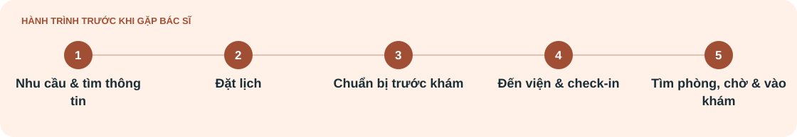

[Minh An](J01-minh-an.md) · **Thanh Hà** · [Minh Đức](J03-minh-duc.md)

# Hành trình của Thanh Hà

**Chăm con và tổ chức lần khám mà không bỏ sót thủ tục**

User journey · Bản final 19/10/2026 · Giả thuyết chưa xác thực

[← Persona Thanh Hà](../01-phong-van/persona/P02-thanh-ha.md)

## Bối cảnh & đích đến

**Mục tiêu của người dùng** 
Đưa con đến đúng lượt khám và vẫn chăm sóc được con trong suốt quá trình chờ gặp bác sĩ.

| Kịch bản | Đích đến của hành trình |
| :--- | :--- |
| Hà tự thu xếp một lần khám ngoại trú cho con tại cơ sở chưa quen, bắt đầu bằng tìm thông tin và đặt lịch. Khi tới viện, Hà vừa thực hiện thủ tục vừa chăm con. Hành trình theo góc nhìn phụ huynh, dừng khi đưa con vào phòng khám; không giả định tuổi, bệnh của con hoặc quyền ưu tiên. | Lịch và hồ sơ đúng trẻ; Hà biết phần chuẩn bị còn thiếu, đưa con tới đúng nơi và vào phòng theo hướng dẫn, đồng thời tìm được hỗ trợ nếu việc chăm con làm gián đoạn. |

## Bản đồ trải nghiệm

*Mỗi cột là một giai đoạn; đọc theo hàng để so sánh mục tiêu, điểm vướng và cảm xúc.*

| Góc nhìn | **[Nhu cầu & tìm thông tin](#nhu-cau-tim-thong-tin)** | **[Đặt lịch](#dat-lich)** | **[Chuẩn bị trước khám](#chuan-bi-truoc-kham)** | **[Đến viện & check-in](#den-vien-check-in)** | **[Tìm phòng, chờ & vào khám](#tim-phong-cho-vao-kham)** |
| :--- | :--- | :--- | :--- | :--- | :--- |
| **🎯 Mục tiêu** | Biết nơi khám phù hợp cho con và cách bắt đầu. | Đặt đúng trẻ và hiểu lịch đã được xác nhận chưa. | Chuẩn bị đủ cho lần khám mà vẫn thu xếp được việc gia đình. | Hoàn tất tiếp nhận cho con mà không bỏ sót hướng dẫn. | Đưa con vào đúng phòng, không mất thông tin khi cần chăm con. |
| **⚠ Điểm vướng** | Thông tin chung chưa nói rõ phụ huynh cần làm gì; dễ phải hỏi nhiều nơi. | Nhầm người đặt với người được khám; chưa rõ gửi yêu cầu khác với đã chốt lịch. | Hướng dẫn rải rác hoặc chưa đúng lần khám khiến phải kiểm tra lại; không tự suy cần nhịn ăn hay ngừng thuốc. | Chăm con làm đứt mạch đọc/nghe hướng dẫn; có nguy cơ bỏ sót nơi đến tiếp. | Có thể lỡ thông báo khi chăm con hoặc tạm rời; chưa biết quy trình xử lý của cơ sở. |
| **♡ Cảm xúc** | Bận tâm vì cần chọn nơi khám và tổ chức việc đưa con đi. | Thận trọng kiểm tra đúng hồ sơ; nhẹ nhõm hơn nếu trạng thái hẹn rõ. | Muốn chuẩn bị đủ nhưng có thể căng vì phải lo nhiều việc cùng lúc. | Dễ sốt ruột nếu phải hỏi lại trong lúc con cần chăm sóc. | Lo lỡ lượt; an tâm hơn khi biết báo ai và cách tiếp tục. |

## Hành động & cơ hội

*Điểm tiếp xúc là kênh theo kịch bản; cơ hội là đề xuất tương lai.*

| Góc nhìn | **[Nhu cầu & tìm thông tin](#nhu-cau-tim-thong-tin)** | **[Đặt lịch](#dat-lich)** | **[Chuẩn bị trước khám](#chuan-bi-truoc-kham)** | **[Đến viện & check-in](#den-vien-check-in)** | **[Tìm phòng, chờ & vào khám](#tim-phong-cho-vao-kham)** |
| :--- | :--- | :--- | :--- | :--- | :--- |
| **Hành động** | • Xem nguồn chính thức về nơi khám và cách đặt hẹn  • Hỏi kênh hỗ trợ nếu chưa biết bắt đầu ở đâu  • Cân đối thời gian đưa con đi khám và chi phí cần hỏi | • Chọn hoặc khai thông tin con là người được khám  • Ghi đúng người lớn nhận liên hệ  • Đọc xác nhận và hỏi lại trạng thái chưa rõ | • Đọc hướng dẫn cho lần khám của con  • Tập hợp hồ sơ, giấy tờ theo yêu cầu đã xác nhận  • Chuẩn bị đồ dùng chăm con và đường đến viện | • Tới điểm tiếp đón  • Đối chiếu đúng tên, ngày sinh của con  • Hỏi phần còn thiếu và điểm đến tiếp theo  • Kiểm tra lại hướng dẫn nếu bị gián đoạn | • Tới đúng phòng chờ và theo dõi gọi lượt  • Hỏi trước cách báo nếu cần đưa con tạm rời chỗ  • Trở lại, xác nhận tình trạng lượt nếu chưa rõ  • Đưa con vào khi được hướng dẫn |
| **Điểm tiếp xúc** | Website chính thức, điện thoại tư vấn; người quen chỉ là nguồn tham khảo. | MyVinmec, website hoặc điện thoại; dùng kênh xác nhận thực tế của lần đặt. | Thông báo hẹn, hồ sơ của con, hướng dẫn chính thức; người trong gia đình nếu có hỗ trợ. | Quầy tiếp đón, nhân viên hướng dẫn, hồ sơ hoặc phiếu; app nếu được áp dụng. | Biển phòng, phiếu hoặc màn hình gọi lượt, nhân viên khu chờ; thông báo điện thoại nếu cơ sở có. |
| **✦ Cơ hội cải thiện** | • Giải thích cách bắt đầu theo vai trò phụ huynh  • Cho thấy đầu mối tư vấn và thông tin dịch vụ liên quan | • Hiển thị rõ trẻ được khám và người liên hệ  • Giải thích trạng thái hẹn, bước tiếp và cách sửa thông tin | • Checklist theo lần khám, có thể đọc lại  • Nội dung chuẩn bị được cơ sở duyệt; không tự tạo yêu cầu y khoa | • Hướng dẫn ngắn theo bước, xác nhận lại sau gián đoạn  • Cho biết việc nào đã hoàn tất và phòng cần tới | • Làm rõ cách báo tạm rời và xử lý lỡ lượt sau khi cơ sở xác minh  • Chọn kênh nhắc phù hợp; không hứa giữ lượt tự động |

---

## Đọc theo từng giai đoạn

*Mở một giai đoạn để trình bày chi tiết hoặc đọc trên màn hình nhỏ.*

<strong>Nhu cầu & tìm thông tin</strong>

| Góc nhìn | Nội dung |
| :--- | :--- |
| **Mục tiêu** | Biết nơi khám phù hợp cho con và cách bắt đầu. |
| **Hành động** | • Xem nguồn chính thức về nơi khám và cách đặt hẹn  • Hỏi kênh hỗ trợ nếu chưa biết bắt đầu ở đâu  • Cân đối thời gian đưa con đi khám và chi phí cần hỏi |
| **Kênh / điểm tiếp xúc** | Website chính thức, điện thoại tư vấn; người quen chỉ là nguồn tham khảo. |
| **Điểm vướng** | Thông tin chung chưa nói rõ phụ huynh cần làm gì; dễ phải hỏi nhiều nơi. |
| **Cảm xúc** | Bận tâm vì cần chọn nơi khám và tổ chức việc đưa con đi. |
| **Cơ hội cải thiện** | • Giải thích cách bắt đầu theo vai trò phụ huynh  • Cho thấy đầu mối tư vấn và thông tin dịch vụ liên quan |

<strong>Đặt lịch</strong>

| Góc nhìn | Nội dung |
| :--- | :--- |
| **Mục tiêu** | Đặt đúng trẻ và hiểu lịch đã được xác nhận chưa. |
| **Hành động** | • Chọn hoặc khai thông tin con là người được khám  • Ghi đúng người lớn nhận liên hệ  • Đọc xác nhận và hỏi lại trạng thái chưa rõ |
| **Kênh / điểm tiếp xúc** | MyVinmec, website hoặc điện thoại; dùng kênh xác nhận thực tế của lần đặt. |
| **Điểm vướng** | Nhầm người đặt với người được khám; chưa rõ gửi yêu cầu khác với đã chốt lịch. |
| **Cảm xúc** | Thận trọng kiểm tra đúng hồ sơ; nhẹ nhõm hơn nếu trạng thái hẹn rõ. |
| **Cơ hội cải thiện** | • Hiển thị rõ trẻ được khám và người liên hệ  • Giải thích trạng thái hẹn, bước tiếp và cách sửa thông tin |

<strong>Chuẩn bị trước khám</strong>

| Góc nhìn | Nội dung |
| :--- | :--- |
| **Mục tiêu** | Chuẩn bị đủ cho lần khám mà vẫn thu xếp được việc gia đình. |
| **Hành động** | • Đọc hướng dẫn cho lần khám của con  • Tập hợp hồ sơ, giấy tờ theo yêu cầu đã xác nhận  • Chuẩn bị đồ dùng chăm con và đường đến viện |
| **Kênh / điểm tiếp xúc** | Thông báo hẹn, hồ sơ của con, hướng dẫn chính thức; người trong gia đình nếu có hỗ trợ. |
| **Điểm vướng** | Hướng dẫn rải rác hoặc chưa đúng lần khám khiến phải kiểm tra lại; không tự suy cần nhịn ăn hay ngừng thuốc. |
| **Cảm xúc** | Muốn chuẩn bị đủ nhưng có thể căng vì phải lo nhiều việc cùng lúc. |
| **Cơ hội cải thiện** | • Checklist theo lần khám, có thể đọc lại  • Nội dung chuẩn bị được cơ sở duyệt; không tự tạo yêu cầu y khoa |

<strong>Đến viện & check-in</strong>

| Góc nhìn | Nội dung |
| :--- | :--- |
| **Mục tiêu** | Hoàn tất tiếp nhận cho con mà không bỏ sót hướng dẫn. |
| **Hành động** | • Tới điểm tiếp đón  • Đối chiếu đúng tên, ngày sinh của con  • Hỏi phần còn thiếu và điểm đến tiếp theo  • Kiểm tra lại hướng dẫn nếu bị gián đoạn |
| **Kênh / điểm tiếp xúc** | Quầy tiếp đón, nhân viên hướng dẫn, hồ sơ hoặc phiếu; app nếu được áp dụng. |
| **Điểm vướng** | Chăm con làm đứt mạch đọc/nghe hướng dẫn; có nguy cơ bỏ sót nơi đến tiếp. |
| **Cảm xúc** | Dễ sốt ruột nếu phải hỏi lại trong lúc con cần chăm sóc. |
| **Cơ hội cải thiện** | • Hướng dẫn ngắn theo bước, xác nhận lại sau gián đoạn  • Cho biết việc nào đã hoàn tất và phòng cần tới |

<strong>Tìm phòng, chờ & vào khám</strong>

| Góc nhìn | Nội dung |
| :--- | :--- |
| **Mục tiêu** | Đưa con vào đúng phòng, không mất thông tin khi cần chăm con. |
| **Hành động** | • Tới đúng phòng chờ và theo dõi gọi lượt  • Hỏi trước cách báo nếu cần đưa con tạm rời chỗ  • Trở lại, xác nhận tình trạng lượt nếu chưa rõ  • Đưa con vào khi được hướng dẫn |
| **Kênh / điểm tiếp xúc** | Biển phòng, phiếu hoặc màn hình gọi lượt, nhân viên khu chờ; thông báo điện thoại nếu cơ sở có. |
| **Điểm vướng** | Có thể lỡ thông báo khi chăm con hoặc tạm rời; chưa biết quy trình xử lý của cơ sở. |
| **Cảm xúc** | Lo lỡ lượt; an tâm hơn khi biết báo ai và cách tiếp tục. |
| **Cơ hội cải thiện** | • Làm rõ cách báo tạm rời và xử lý lỡ lượt sau khi cơ sở xác minh  • Chọn kênh nhắc phù hợp; không hứa giữ lượt tự động |

---

<strong>Nguồn nội dung và ghi chú phương pháp</strong>

Tên hư cấu; nội dung theo bản final tác giả cung cấp ngày 19/10/2026. Chân dung, câu nói và hành trình chưa được xác thực qua nghiên cứu.

[Đề bài](../README.md) · [Phương pháp và nguồn](../04-best-practice/phuong-phap-persona-journey-qualtrics.md)

Nguồn bối cảnh: [hồ sơ cá nhân và người thân MyVinmec](https://www.vinmec.com/vie/bai-viet/huong-dan-ket-noi-ho-so-y-te-va-so-tiem-chung-tren-ung-dung-myvinmec-vi).

**Phạm vi:** Từ nhu cầu đi khám đến khi vào phòng khám lâm sàng. Áp dụng cho phần tiếp nhận của cả lần khám đầu và khám lại; kết thúc trước nội dung khám, xét nghiệm và thanh toán.

Hành động, khó khăn và cảm xúc là giả thuyết; các kênh là lựa chọn theo tình huống. Hàng Cơ hội mô tả tương lai, chưa phải tính năng hay quy trình hiện có. Không dùng các nguồn công khai để xác nhận một người đã trải qua điểm đau trong bản đồ.

**[← Xem persona Thanh Hà](../01-phong-van/persona/P02-thanh-ha.md)**

[Minh An](J01-minh-an.md) · **Thanh Hà** · [Minh Đức](J03-minh-duc.md)
