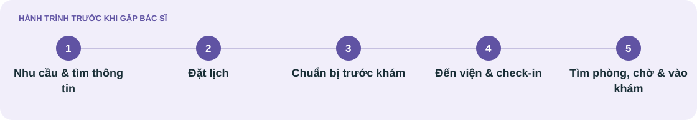

[Minh An](J01-minh-an.md) · [Thanh Hà](J02-thanh-ha.md) · **Minh Đức**

# Hành trình của Minh Đức

**Chủ động đi khám khi không có con cái đi cùng**

User journey · Bản final 19/10/2026 · Giả thuyết chưa xác thực

[← Persona Minh Đức](../01-phong-van/persona/P03-minh-duc.md)

## Bối cảnh & đích đến

**Mục tiêu của người dùng** 
Tự đi đến đúng phòng và vào khám, hiểu mình đang ở bước nào và chủ động nhận hỗ trợ khi cần.

| Kịch bản | Đích đến của hành trình |
| :--- | :--- |
| Đức tự thu xếp khám ngoại trú ở cơ sở chưa quen khi không có con cái đi cùng. Có thể đặt lịch qua điện thoại hoặc kênh số phù hợp; khi cần, chủ động hỏi nhân viên và dùng giấy ghi để kiểm tra lại. Dừng khi vào phòng khám, không mặc định đi một mình trong mọi lần khám hoặc cần trợ giúp ở mọi bước. | Đức kiểm tra được lịch, hoàn tất tiếp nhận, tới đúng phòng, theo dõi được thông báo và vào khám; nếu một hướng dẫn chưa rõ, tìm được hỗ trợ để tiếp tục theo cách mình chọn. |

## Bản đồ trải nghiệm

*Mỗi cột là một giai đoạn; đọc theo hàng để so sánh mục tiêu, điểm vướng và cảm xúc.*

| Góc nhìn | **[Nhu cầu & tìm thông tin](#nhu-cau-tim-thong-tin)** | **[Đặt lịch](#dat-lich)** | **[Chuẩn bị trước khám](#chuan-bi-truoc-kham)** | **[Đến viện & check-in](#den-vien-check-in)** | **[Tìm phòng, chờ & vào khám](#tim-phong-cho-vao-kham)** |
| :--- | :--- | :--- | :--- | :--- | :--- |
| **🎯 Mục tiêu** | Biết nơi và cách bắt đầu việc khám theo nhu cầu. | Biết chắc ngày giờ, cơ sở và tình trạng hẹn. | Có đủ thông tin và giấy tờ để tự tới khám. | Biết đã được tiếp nhận và nơi cần tới tiếp. | Tới đúng phòng, theo dõi được lượt và chủ động vào khám. |
| **⚠ Điểm vướng** | Không rõ nơi hỏi; nhiều kênh có thể đưa thông tin khác nhau. | Không lưu hoặc nghe lại được lịch; dễ chưa chắc yêu cầu hẹn đã được xác nhận. | Nhiều hướng dẫn cùng lúc, địa chỉ hoặc điểm tiếp đón chưa cụ thể khiến khó kiểm tra đã chuẩn bị đủ. | Có mặt tại viện nhưng chưa rõ đã được ghi nhận; chỉ dẫn bằng tên không khớp biển hoặc chỉ có trên app. | Không chắc đúng phòng hoặc đã đến lượt; chưa biết nên hỏi ai nếu thông báo không rõ. |
| **♡ Cảm xúc** | Muốn tự sắp xếp; Phân vân nếu không tìm được nguồn tin rõ. | Yên tâm hơn khi có cách kiểm tra lại, vẫn băn khoăn nếu chỉ nghe một lần. | Chủ động khi có danh sách ngắn và điểm đến rõ. | Lúng túng vì nơi mới; tự tin hơn khi xác nhận được bước tiếp. | Sốt ruột hoặc lo bỏ lỡ; nhẹ nhõm khi biết đúng phòng và cách hỏi. |

## Hành động & cơ hội

*Điểm tiếp xúc là kênh theo kịch bản; cơ hội là đề xuất tương lai.*

| Góc nhìn | **[Nhu cầu & tìm thông tin](#nhu-cau-tim-thong-tin)** | **[Đặt lịch](#dat-lich)** | **[Chuẩn bị trước khám](#chuan-bi-truoc-kham)** | **[Đến viện & check-in](#den-vien-check-in)** | **[Tìm phòng, chờ & vào khám](#tim-phong-cho-vao-kham)** |
| :--- | :--- | :--- | :--- | :--- | :--- |
| **Hành động** | • Nhờ con cái thông tin hộ   • Nghe theo hướng dẫn từ nhân viên tổng đài  • Kiểm tra địa chỉ và cách liên hệ chính thức | • Đặt lịch qua điện thoại hoặc kênh số phù hợp  • Nhắc lại hoặc xem lại ngày giờ, địa điểm  • Hỏi cách liên hệ nếu kế hoạch thay đổi | • Lưu xác nhận hoặc ghi lại thông tin hẹn  • Chuẩn bị giấy tờ theo hướng dẫn  • Xác định đường đi và điểm tiếp đón | • Tới quầy, cung cấp thông tin cần thiết  • Kiểm tra việc ghi nhận có mặt  • Hỏi tên phòng, hướng đi và nơi hỗ trợ nếu chưa rõ | • Theo chỉ dẫn tới phòng, đối chiếu biển tên  • Kiểm tra cách gọi lượt  • Hỏi nhân viên khi chưa chắc đúng nơi hoặc lượt  • Vào phòng theo hướng dẫn |
| **Điểm tiếp xúc** | Điện thoại (gần như chỉ nghe gọi), nhân viên hoặc người quen; xác minh lại thông tin chính thức. | Điện thoại hoặc hỗ trợ tại cơ sở; xác nhận qua kênh người khám dùng được. | Thông báo hẹn, giấy ghi, hướng dẫn có thể đọc/nghe lại; điện thoại hỗ trợ. | Nhân viên tiếp đón, biển hướng dẫn, phiếu hoặc điện thoại nếu sử dụng. | Biển phòng, phiếu, màn hình/thông báo gọi lượt và nhân viên khu chờ. |
| **✦ Cơ hội cải thiện** | • Cung cấp điểm liên hệ rõ, thông tin nhất quán  • Giữ lựa chọn số và trao đổi trực tiếp | • Xác nhận lịch bằng kênh người đi khám chọn  • Cho phép kiểm tra lại ngày giờ, nơi đến và trạng thái | • Hướng dẫn ngắn, chữ rõ, có thể đọc/nghe lại  • Không yêu cầu con cái thao tác hộ để tiếp tục | • Xác nhận đã tiếp nhận và chỉ một điểm đến tiếp  • Dùng tên phòng nhất quán; hỗ trợ theo nhu cầu thực tế | • Xác nhận đúng khu chờ và cách gọi lượt  • Điểm hỏi dễ tìm, có lựa chọn ngoài điện thoại; giữ quyền tự phục vụ |

---

## Đọc theo từng giai đoạn

*Mở một giai đoạn để trình bày chi tiết hoặc đọc trên màn hình nhỏ.*

<strong>Nhu cầu & tìm thông tin</strong>

| Góc nhìn | Nội dung |
| :--- | :--- |
| **Mục tiêu** | Biết nơi và cách bắt đầu việc khám theo nhu cầu. |
| **Hành động** | • Nhờ con cái thông tin hộ   • Nghe theo hướng dẫn từ nhân viên tổng đài  • Kiểm tra địa chỉ và cách liên hệ chính thức |
| **Kênh / điểm tiếp xúc** | Điện thoại (gần như chỉ nghe gọi), nhân viên hoặc người quen; xác minh lại thông tin chính thức. |
| **Điểm vướng** | Không rõ nơi hỏi; nhiều kênh có thể đưa thông tin khác nhau. |
| **Cảm xúc** | Muốn tự sắp xếp; Phân vân nếu không tìm được nguồn tin rõ. |
| **Cơ hội cải thiện** | • Cung cấp điểm liên hệ rõ, thông tin nhất quán  • Giữ lựa chọn số và trao đổi trực tiếp |

<strong>Đặt lịch</strong>

| Góc nhìn | Nội dung |
| :--- | :--- |
| **Mục tiêu** | Biết chắc ngày giờ, cơ sở và tình trạng hẹn. |
| **Hành động** | • Đặt lịch qua điện thoại hoặc kênh số phù hợp  • Nhắc lại hoặc xem lại ngày giờ, địa điểm  • Hỏi cách liên hệ nếu kế hoạch thay đổi |
| **Kênh / điểm tiếp xúc** | Điện thoại hoặc hỗ trợ tại cơ sở; xác nhận qua kênh người khám dùng được. |
| **Điểm vướng** | Không lưu hoặc nghe lại được lịch; dễ chưa chắc yêu cầu hẹn đã được xác nhận. |
| **Cảm xúc** | Yên tâm hơn khi có cách kiểm tra lại, vẫn băn khoăn nếu chỉ nghe một lần. |
| **Cơ hội cải thiện** | • Xác nhận lịch bằng kênh người đi khám chọn  • Cho phép kiểm tra lại ngày giờ, nơi đến và trạng thái |

<strong>Chuẩn bị trước khám</strong>

| Góc nhìn | Nội dung |
| :--- | :--- |
| **Mục tiêu** | Có đủ thông tin và giấy tờ để tự tới khám. |
| **Hành động** | • Lưu xác nhận hoặc ghi lại thông tin hẹn  • Chuẩn bị giấy tờ theo hướng dẫn  • Xác định đường đi và điểm tiếp đón |
| **Kênh / điểm tiếp xúc** | Thông báo hẹn, giấy ghi, hướng dẫn có thể đọc/nghe lại; điện thoại hỗ trợ. |
| **Điểm vướng** | Nhiều hướng dẫn cùng lúc, địa chỉ hoặc điểm tiếp đón chưa cụ thể khiến khó kiểm tra đã chuẩn bị đủ. |
| **Cảm xúc** | Chủ động khi có danh sách ngắn và điểm đến rõ. |
| **Cơ hội cải thiện** | • Hướng dẫn ngắn, chữ rõ, có thể đọc/nghe lại  • Không yêu cầu con cái thao tác hộ để tiếp tục |

<strong>Đến viện & check-in</strong>

| Góc nhìn | Nội dung |
| :--- | :--- |
| **Mục tiêu** | Biết đã được tiếp nhận và nơi cần tới tiếp. |
| **Hành động** | • Tới quầy, cung cấp thông tin cần thiết  • Kiểm tra việc ghi nhận có mặt  • Hỏi tên phòng, hướng đi và nơi hỗ trợ nếu chưa rõ |
| **Kênh / điểm tiếp xúc** | Nhân viên tiếp đón, biển hướng dẫn, phiếu hoặc điện thoại nếu sử dụng. |
| **Điểm vướng** | Có mặt tại viện nhưng chưa rõ đã được ghi nhận; chỉ dẫn bằng tên không khớp biển hoặc chỉ có trên app. |
| **Cảm xúc** | Lúng túng vì nơi mới; tự tin hơn khi xác nhận được bước tiếp. |
| **Cơ hội cải thiện** | • Xác nhận đã tiếp nhận và chỉ một điểm đến tiếp  • Dùng tên phòng nhất quán; hỗ trợ theo nhu cầu thực tế |

<strong>Tìm phòng, chờ & vào khám</strong>

| Góc nhìn | Nội dung |
| :--- | :--- |
| **Mục tiêu** | Tới đúng phòng, theo dõi được lượt và chủ động vào khám. |
| **Hành động** | • Theo chỉ dẫn tới phòng, đối chiếu biển tên  • Kiểm tra cách gọi lượt  • Hỏi nhân viên khi chưa chắc đúng nơi hoặc lượt  • Vào phòng theo hướng dẫn |
| **Kênh / điểm tiếp xúc** | Biển phòng, phiếu, màn hình/thông báo gọi lượt và nhân viên khu chờ. |
| **Điểm vướng** | Không chắc đúng phòng hoặc đã đến lượt; chưa biết nên hỏi ai nếu thông báo không rõ. |
| **Cảm xúc** | Sốt ruột hoặc lo bỏ lỡ; nhẹ nhõm khi biết đúng phòng và cách hỏi. |
| **Cơ hội cải thiện** | • Xác nhận đúng khu chờ và cách gọi lượt  • Điểm hỏi dễ tìm, có lựa chọn ngoài điện thoại; giữ quyền tự phục vụ |

---

<strong>Nguồn nội dung và ghi chú phương pháp</strong>

Tên hư cấu; nội dung theo bản final tác giả cung cấp ngày 19/10/2026. Chân dung, câu nói và hành trình chưa được xác thực qua nghiên cứu.

[Đề bài](../README.md) · [Phương pháp và nguồn](../04-best-practice/README.md#phuong-phap-persona-journey)

Nguồn bối cảnh: [WHO về tuổi cao](https://www.who.int/news-room/fact-sheets/detail/ageing-and-health) · [Thông tin dễ tiếp cận](https://extranet.who.int/agefriendlyworld/age-friendly-practices/communication-and-information/).

**Phạm vi:** Từ nhu cầu đi khám đến khi vào phòng khám lâm sàng. Áp dụng cho phần tiếp nhận của cả lần khám đầu và khám lại; kết thúc trước nội dung khám, xét nghiệm và thanh toán.

Hành động, khó khăn và cảm xúc là giả thuyết; các kênh là lựa chọn theo tình huống. Hàng Cơ hội mô tả tương lai, chưa phải tính năng hay quy trình hiện có. Không dùng các nguồn công khai để xác nhận một người đã trải qua điểm đau trong bản đồ.

**[← Xem persona Minh Đức](../01-phong-van/persona/P03-minh-duc.md)**

[Minh An](J01-minh-an.md) · [Thanh Hà](J02-thanh-ha.md) · **Minh Đức**
